<p align="center">
  
</p>

<p align="center">
  <a href="https://github.com/wolfebase/broadwave/actions/workflows/ci.yml"></a>
  <a href="https://github.com/wolfebase/broadwave/releases/latest"></a>
  <a href="https://github.com/wolfebase/broadwave/pkgs/container/broadwave"></a>
  <a href="https://testflight.apple.com/join/893B2HRj"></a>
  <a href="LICENSE"></a>
</p>

<h3 align="center">
  Live TV and DVR for your antenna, on every screen in the house, in sync.<br>
  Self-hosted, free, and open source. No subscription, no account.
</h3>

<p align="center">
  <a href="#quick-start"><b>Quick start</b></a> &nbsp;·&nbsp;
  <a href="#why-broadwave"><b>Why Broadwave</b></a> &nbsp;·&nbsp;
  <a href="#what-it-looks-like"><b>Screens</b></a> &nbsp;·&nbsp;
  <a href="#install"><b>Install</b></a> &nbsp;·&nbsp;
  <a href="#apps"><b>Apps</b></a> &nbsp;·&nbsp;
  <a href="#questions"><b>FAQ</b></a> &nbsp;·&nbsp;
  <a href="docs/guide/index.md"><b>Handbook</b></a>
</p>

<p align="center"></p>

## Quick start

You need an antenna, a network TV tuner such as any current [HDHomeRun](docs/tuners.md), and an always-on computer that runs Docker: a mini PC, a NAS, or a home server, on x86-64 or ARM64.

On that computer, if it runs Linux:

```bash
curl -fsSL https://raw.githubusercontent.com/wolfebase/broadwave/main/scripts/install.sh | bash
```

Then open **`http://<that computer>:8477`**. Broadwave finds your tuner, scans the channels, and fills the guide.

The script checks Docker, your time zone, your user, graphics, and the port, then starts one container with host networking. Run it again to update: it keeps your folders and settings, and holds off while a tuner is in use or a recording is near. Add `bash -s -- --dry-run` to see each command first, or [read what it does](docs/guide/install.md#one-command). On Unraid, a NAS, Docker Desktop, or without Docker, see [Install](#install).

<p align="center"></p>

## Why Broadwave

Plug an antenna into a network tuner, run Broadwave on one always-on box, and every phone, tablet, TV, and browser in the house becomes a TV. The broadcasts are already in the air for free. Broadwave makes them feel like a paid live TV service, without the bill.

- **Whole-Home Sync.** Every screen on the same channel plays the same frame, so the kitchen never cheers before the living room. Measured 15 ms apart on a real broadcast. Watch together, and pause or rewind moves every screen in the group. [How sync works](docs/guide/sync.md)
- **One tuner, every screen.** Only the server talks to the tuner. Everyone on a channel shares one tune, and so do recordings, so three TVs on the game use one tuner. Plex, Jellyfin, Emby, and Channels can use Broadwave as their tuner too.
- **A DVR that gets sports.** Follow a team and every game records. A game that runs long keeps recording until it's final. Recordings are the untouched broadcast, in original quality.
- **The guide is the centerpiece.** A fast guide with artwork and a live preview while you browse, a mini-guide over the player, and search across the guide and your recordings.
- **Automatic, with overrides.** It finds your tuners and screens on its own, and picks direct play, bitrate, surround sound, and frame rate for each screen. True 60 fps, film back at 24p. Every screen can pick its own quality and sound.

<p align="center"></p>

<p align="center"></p>
<p align="center"></p>
<p align="center"></p>

<details>
<summary><b>Everything it does</b></summary>
<br>

| | |
| --- | --- |
| **Watch** | Live TV on every screen, in sync · one tune shared by everyone on a channel · true 60 fps, film restored to 24p · hardware transcoding on Intel and AMD graphics · 5.1 surround with a picker for languages and described video · ATSC 3.0 where the tuner receives it · buffers tuned for phones, desktops, and TVs · a stream panel that shows exactly what's happening |
| **Record** | Shows, series, or every game for your team · the untouched broadcast, in original quality · games keep recording until they're final · a tuner held back for recordings · a heads-up before live TV would take a recording's tuner · a later airing suggested when one can't record · nightly backups with one-tap restore. [How recordings work](docs/recordings.md) |
| **Guide** | About 2 days of listings free from SiliconDust for an HDHomeRun, 14 days with an HDHomeRun DVR subscription or Schedules Direct · also XMLTV, or the broadcast itself · artwork, seasons, premieres, and finales · search across the guide and your recordings · antenna and signal tools that say *Great, OK, Weak,* or *Lost* |
| **Multiview** | Side by side, one-big-plus-three, quad, and picture-in-picture · sound and 60 fps follow the tile you pick · a Game Switcher that moves the big tile to the game that matters · saved layouts. [How multiview works](docs/multiview.md) |
| **Sports** | Live scores for thirteen leagues, plus F1, NASCAR, and IndyCar schedules · follow teams and record every game · a heads-up when your team starts or a game gets close, with Watch · scores you can hide |
| **Setup** | Finds your tuners, servers, and screens on its own · done in about 90 seconds · a setup doctor for networking, graphics, disks, time zone, and permissions · a banner when a new device shows up · [what each error means](docs/troubleshooting.md) |
| **Private** | No account, no ads, no analytics · your channels, recordings, and history stay on your server · support bundles with secrets stripped out · open-source server, Apache 2.0. [Privacy](PRIVACY.md) |

</details>

## What it looks like

The Apple TV, iPad, and iPhone apps. These are from the demo: Blender's open movies on made-up stations.

<p align="center"></p>
<p align="center"></p>

The web app: Home, the guide, live TV, two channels side by side, and recordings. The phone uses the same server. The picture is a test pattern and the stations are made up.

<table>
  <tr>
    <td width="72%">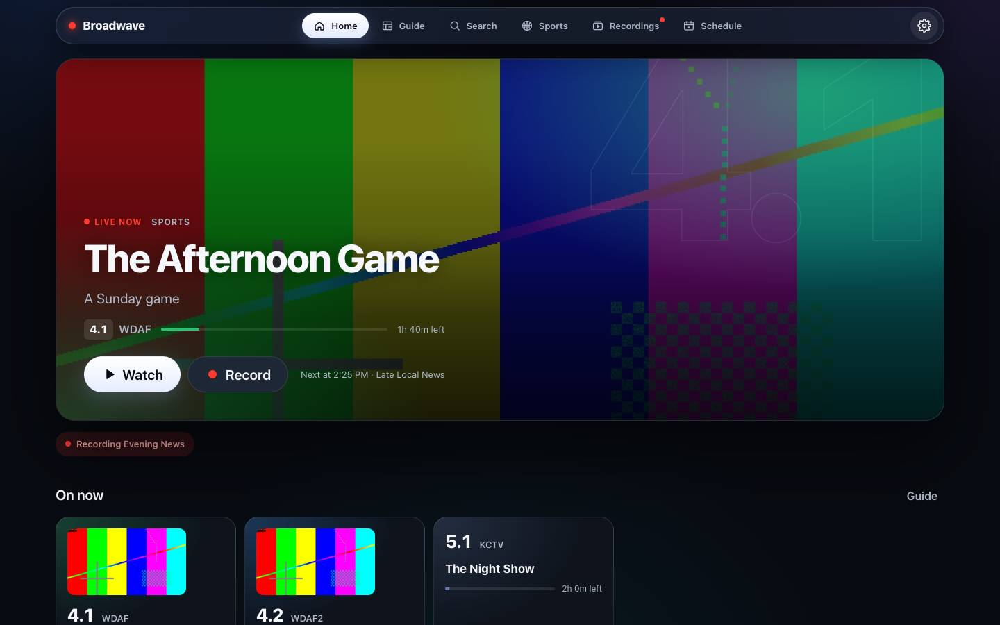</td>
    <td>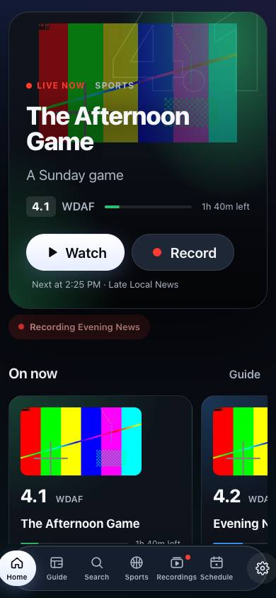</td>
  </tr>
  <tr>
    <td>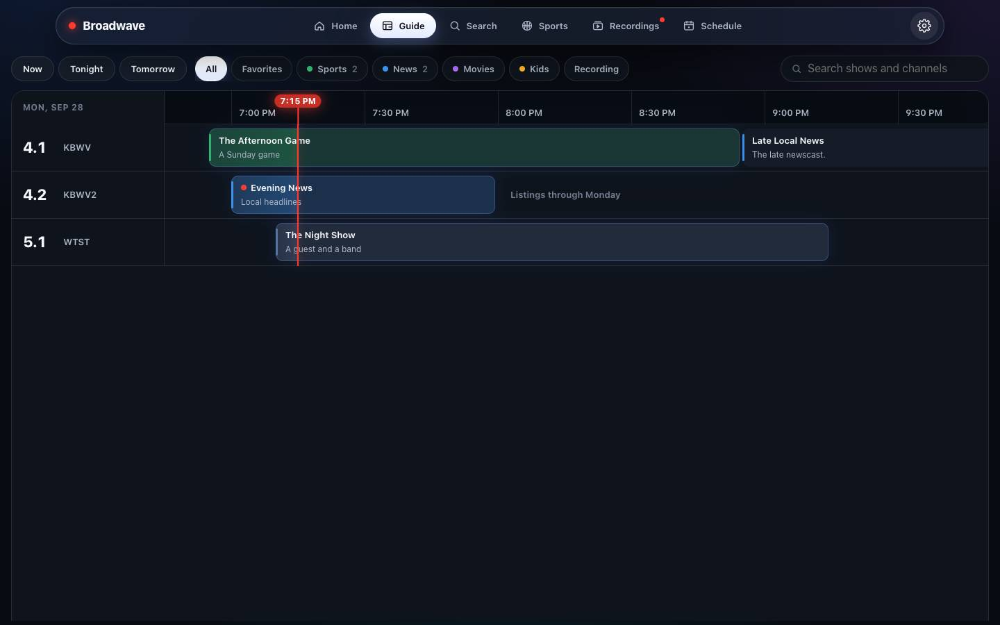</td>
    <td>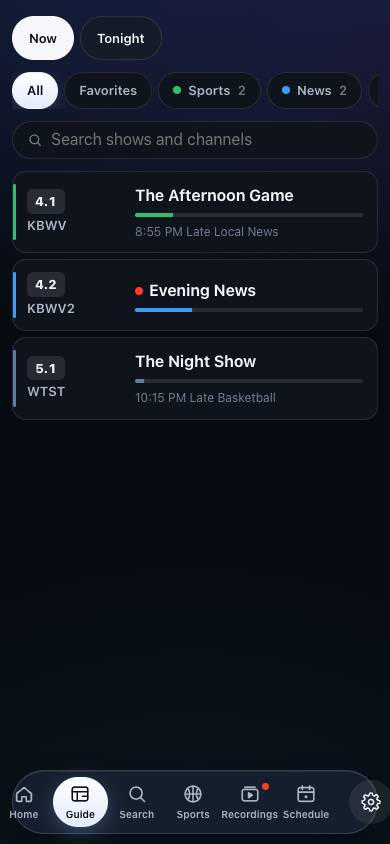</td>
  </tr>
  <tr>
    <td>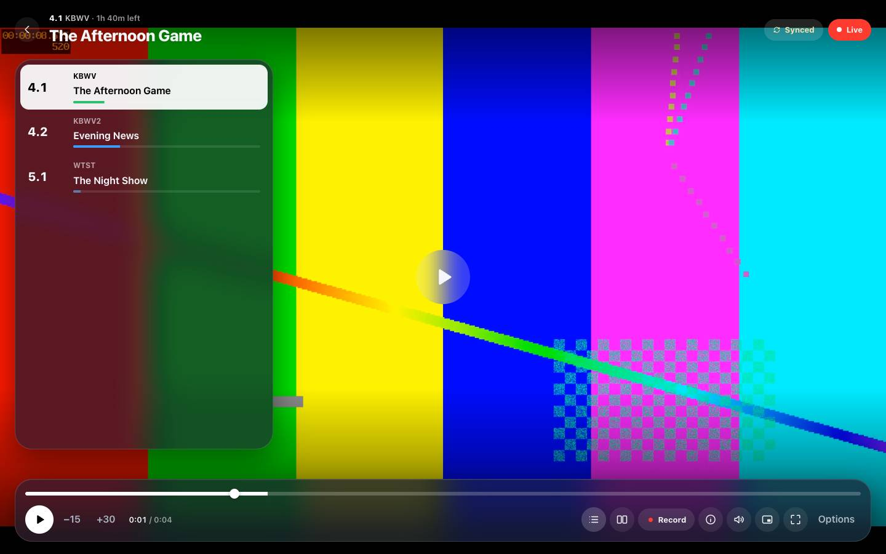</td>
    <td>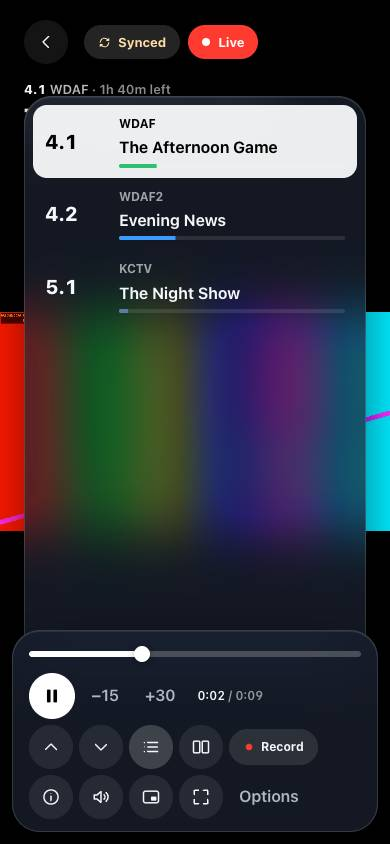</td>
  </tr>
  <tr>
    <td>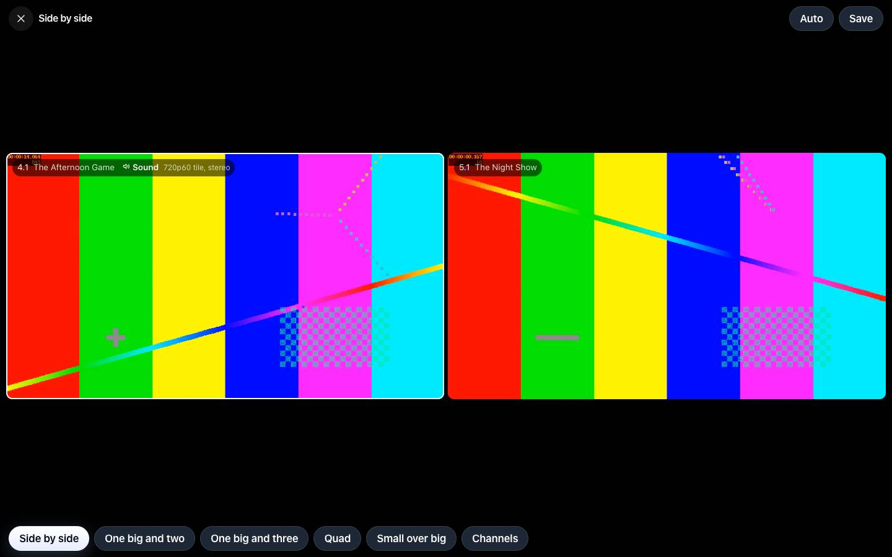</td>
    <td>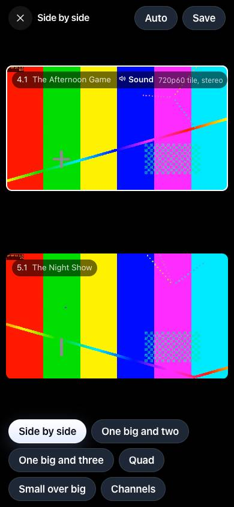</td>
  </tr>
  <tr>
    <td>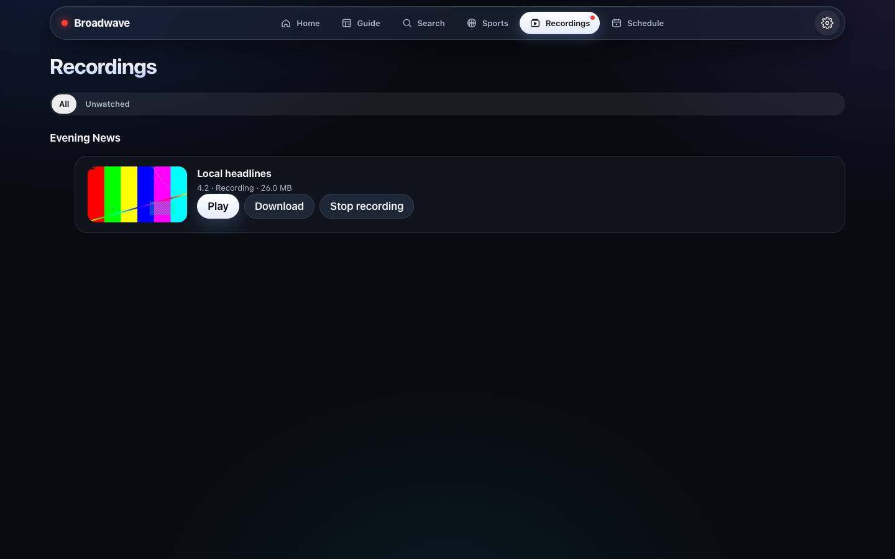</td>
    <td>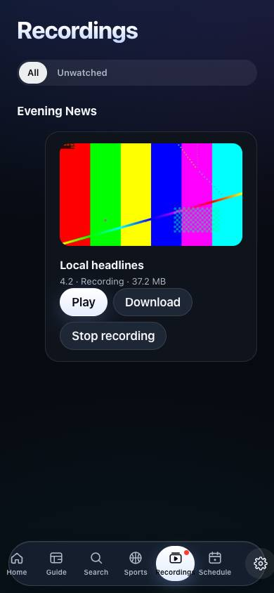</td>
  </tr>
</table>

## Install

One image, `ghcr.io/wolfebase/broadwave`, for x86-64 and ARM64, with its own ffmpeg. `latest` is the newest release; a version tag such as `0.18.2` stays put.

| Your computer | How |
| --- | --- |
| Linux with Docker: a mini PC, a home server, a Raspberry Pi 4 or 5 (64-bit) | [The one command](#quick-start), or [`docker run`](docs/guide/install.md#docker-on-linux) |
| Unraid | Search for **Broadwave** in the Apps tab. [What each setting means](docs/guide/install.md#unraid) |
| Synology, QNAP, TrueNAS SCALE | [Compose in the NAS app](docs/guide/install.md#nas-boxes) |
| Any Docker host, with Compose | [`compose.yaml`](docs/guide/install.md#docker-compose) |
| A Mac with Docker Desktop | The one command; add `bash -s -- --tuner <address>` if it can't find the tuner |
| Windows with Docker Desktop | [Published ports](docs/guide/install.md#docker-desktop-on-mac-or-windows) |
| No Docker (Linux, macOS, Windows) | [The server as one file](docs/guide/install.md#without-docker) from each release |

<details>
<summary><b>The same thing with <code>docker run</code></b></summary>
<br>

```bash
docker run -d --name broadwave --network host --restart unless-stopped \
  -e TZ=<your time zone> \
  -e PUID=$(id -u) -e PGID=$(id -g) \
  -v ~/broadwave:/config \
  -v ~/broadwave/recordings:/config/work/recordings \
  ghcr.io/wolfebase/broadwave:latest
```

- **`--network host`** lets a Linux server hear your tuner, and lets phones and TVs find Broadwave. Keep it.
- **`TZ`** is your time zone, such as `America/New_York`, `America/Chicago`, `America/Denver`, or `America/Los_Angeles`. Without it the server runs on UTC and records at the wrong hour; it says so in its log, on Diagnostics, and to an admin in the web app.
- **`PUID`, `PGID`** make the config and recordings yours instead of root's.
- **Graphics.** Add `--device /dev/dri` when that path exists (Intel or AMD). Docker refuses to start if it is missing. The picture still plays without it. NVIDIA: [Graphics](docs/guide/install.md#graphics).
- **Tuner address.** When the tuner does not appear, enter its address on the setup page, or set `HDHR_HOST`.

Every setting: [Install › Other settings](docs/guide/install.md#other-settings).

</details>

### Updating

Run the one command again, `docker compose pull && docker compose up -d` with Compose, or apply the update from Unraid's Docker tab. The folders stay; only the container is replaced, and the database is copied before a new version changes it. An optional updater can do it every night at 03:30, skipping nights when a tuner is in use or a recording is near: [Automatic updates](docs/guide/install.md#automatic-updates). Without one, the web app says when a new release is out.

## Apps

- **Any browser** at `http://<your-server>:8477`: live TV, the guide, recordings, multiview, and every setting. Nothing to install. On a phone, add it to the home screen.
- **iPhone, iPad, and Apple TV** apps are in public beta on [TestFlight](https://testflight.apple.com/join/893B2HRj). They list the servers they find on your home network. You pick one, or you type an address. With no server, Try the demo plays sample films.
- **Away from home.** In Settings › Devices and away from home, choose Sign in with Cloudflare. Broadwave makes a tunnel and an address on your domain, and only devices you pair or invite can open it. With no domain, use Tailscale. Never forward port 8477. [Away from home](docs/guide/remote.md)

## Works with

| | |
| --- | --- |
| **Tuners** | HDHomeRun and compatible network tuners, several at once, with automatic failover. [Tuners](docs/tuners.md) |
| **Playlists** | M3U (file or URL, with `tvg-*` tags and its own guide) and Xtream Codes |
| **Other TV servers** | tvheadend, Channels DVR, Threadfin, xTeVe, ErsatzTV, Dispatcharr, Antennas |
| **Free streaming channels** | Popular free ad-supported services through a FastChannels container |
| **Guide data** | Your tuner's guide, Schedules Direct, any XMLTV address, or the broadcast itself |
| **Media servers** | Plex, Jellyfin, Emby, and Channels can add Broadwave as an HDHomeRun, or read its M3U and XMLTV |
| **Screens** | Phones, tablets, TVs, and any modern browser |

## Questions

<details>
<summary><b>Does it cost anything?</b></summary>
<br>No. Broadwave is free, and the server is open source: no subscription, no account, no ads. Over-the-air TV is free too; you need an antenna and a network tuner. The free guide for an HDHomeRun covers about 2 days; an HDHomeRun DVR subscription or Schedules Direct covers 14.
</details>

<details>
<summary><b>Where does the content come from?</b></summary>
<br>From your antenna. Broadwave doesn't provide, host, or stream any content itself; it plays the free broadcasts your own tuner receives, plus any playlists you add.
</details>

<details>
<summary><b>Which tuner should I get?</b></summary>
<br>Any current HDHomeRun works out of the box, and Broadwave finds it on its own. Other network tuners work by address. [How tuners are found](docs/tuners.md). A FLEX 4K also receives ATSC 3.0 on two of its four tuners. [How that works](docs/atsc3.md).
</details>

<details>
<summary><b>Where do recordings go?</b></summary>
<br>In the recordings folder you mounted. By default they are filed by show for Plex and Jellyfin, and Settings can put them all in one folder. Each recording is the broadcast file, with a small file beside it for the title, channel, and times. [How recordings work](docs/recordings.md).
</details>

<details>
<summary><b>Can I watch more than one channel?</b></summary>
<br>Yes, when this server has room for that many pictures. Side by side, one large picture with smaller ones beside it, or four at once, on the web, iPad, and Apple TV. The iPhone app shows two. One tile has the sound. [How that works](docs/multiview.md).
</details>

<details>
<summary><b>Is it safe to open to the internet?</b></summary>
<br>Don't forward the port. There is no account password: anything that can open port 8477 can use the server until you turn on device sign-in in Settings › Devices. Sign in with Cloudflare and a reverse proxy both need a paired device for every request. [Security](docs/guide/security.md).
</details>

<details>
<summary><b>Something isn't working</b></summary>
<br>The player says what failed and what to try. On the web, Diagnostics shows the tuners, the disk, and the recent log. On the Apple apps it shows Fix these, guide depth, tuner health, and antenna readings. Settings can download a support bundle with secrets stripped out. [What each message means](docs/troubleshooting.md) · [Common problems](docs/guide/problems.md) · [Open an issue](https://github.com/wolfebase/broadwave/issues).
</details>

## Contributing

Bug reports and pull requests for the server and web app are welcome. Open an [issue](https://github.com/wolfebase/broadwave/issues) first for anything large. The native apps live in a separate repository and are not open source.

You need Go 1.26+, Node 22+, and ffmpeg.

```bash
make run      # build the web app and run the server on :8477 with ./data
make dev      # API with CORS for Vite; then: cd web && npm run dev
make check    # what CI runs: tests, lint, API drift, and a relay test with a fake tuner
```

Tests never open a real tuner. [`docs/architecture.md`](docs/architecture.md) explains how it works, [`docs/security.md`](docs/security.md) covers the boundaries, and [`docs/decisions/`](docs/decisions) records why. The HTTP API is [`api/openapi.yaml`](api/openapi.yaml).

## License

The server and web app are [Apache 2.0](LICENSE). The iPhone, iPad, and Apple TV apps are not open source. ffmpeg and comskip run as separate programs under their own licenses; see [`NOTICE`](NOTICE). [Privacy](PRIVACY.md) · [Support](SUPPORT.md). Demo imagery is from the Blender Foundation's open movies (CC BY).

<p align="center">
  <br>
  <sub>Made by <b>Wolfe Up LLC</b>. The TV in the sky was always free.</sub>
</p>
